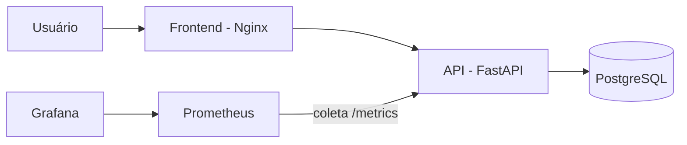

# ChamaTech

> Plataforma SaaS de suporte ao cliente (help desk) construída com microsserviços em Docker, preparada para escalar com Kubernetes e monitorada com Prometheus e Grafana.

**Disciplina:** DevOps e Engenharia de Plataforma — CEUB
**Professor:** Wagner Pequeno
**Projeto selecionado:** 1 — SaaS de suporte ao cliente

---

## 👩‍💻 Integrantes

| Nome | Área principal |
|---|---|
| Isadora | Frontend, UML e coordenação do repositório |
| Ellen | Dockerfiles, Docker Compose e Kubernetes |
| Ana Clara | Backend, Banco de Dados e Observabilidade |

---

## 🎯 Motivo da seleção do projeto

- Ferramentas de suporte ao cliente são essenciais para negócios online de qualquer tamanho e estão em alta no mercado SaaS.
- Um sistema de help desk se divide naturalmente em serviços independentes (frontend, API, banco de dados e monitoramento), o que se encaixa bem em uma arquitetura de microsserviços.
- O escopo é viável para um grupo de três pessoas e permite demonstrar na prática Docker, Kubernetes e observabilidade.
- Os chamados, usuários e métricas geram dados e carga reais para testar escalabilidade e monitoramento.

---

## 📖 Descrição

O **ChamaTech** permite que clientes abram chamados de suporte e que atendentes os gerenciem em um único lugar, com acompanhamento de status, prazos (SLA) e uma base de conhecimento para autoatendimento.

### Funcionalidades

**Essenciais (MVP)**
- [ ] Cadastro e login de usuários (cliente e atendente)
- [ ] CRUD de chamados (título, descrição, prioridade, status)
- [ ] Comentários e respostas nos chamados
- [ ] Endpoints de saúde (`/health`) e de métricas (`/metrics`)

**Diferenciais**
- [ ] Portal de FAQ com busca de artigos (autoatendimento)
- [ ] Dashboard com chamados por status e tempo médio de resposta
- [ ] Chatbot por regras (palavras-chave) para dúvidas frequentes
- [ ] Notificação por e-mail (MailHog em ambiente de teste)

---

## 🏗️ Arquitetura

O diagrama de arquitetura em UML está em [`docs/arquitetura.md`](docs/arquitetura.md), com as imagens em `docs/img/`.



### Tecnologias

| Camada | Tecnologia |
|---|---|
| Backend | Python + FastAPI |
| Frontend | HTML, CSS, JavaScript + Nginx |
| Banco de dados | PostgreSQL (imagem oficial do Docker Hub) |
| Contêineres | Docker e Docker Compose |
| Orquestração | Kubernetes (Deployment, Service, ConfigMap, Secret, HPA) |
| Observabilidade | Prometheus + Grafana |
| CI | GitHub Actions |

---

## 📁 Estrutura do repositório

```
chamatech/
├── README.md
├── docker-compose.yml
├── .env.example
├── docs/                 # UML e decisões de arquitetura
├── backend/              # código da API + Dockerfile
├── frontend/             # interface + Dockerfile
├── k8s/                  # manifestos Kubernetes
├── observability/        # prometheus.yml e dashboards do Grafana
└── .github/workflows/    # pipeline de CI
```

---

## 🚀 Como executar

### Pré-requisitos
- Docker e Docker Compose
- Git
- Minikube ou kind + kubectl (para a execução no Kubernetes)

### Com Docker Compose

```bash
git clone <URL-DO-REPOSITORIO>
cd chamatech
cp .env.example .env
docker compose up --build
```

| Serviço | URL |
|---|---|
| Frontend | http://localhost:8080 |
| API | http://localhost:8000 |
| Prometheus | http://localhost:9090 |
| Grafana | http://localhost:3000 |

### Com Kubernetes

```bash
kubectl apply -f k8s/
kubectl get pods
```

A API é executada em um Deployment com múltiplas réplicas e um HorizontalPodAutoscaler (HPA), que aumenta o número de pods conforme o uso de CPU.

---

## 📊 Observabilidade

- A API expõe métricas em `/metrics` (requisições, latência e erros).
- O Prometheus coleta essas métricas periodicamente.
- O Grafana exibe os dashboards em `observability/grafana/`.

---

## 🗂️ Divisão de tarefas

### Isadora — Frontend, UML e coordenação do repositório
- [ ] Criar o repositório privado, o quadro Kanban e organizar as branches
- [ ] Construir as telas: login, lista e detalhe de chamados, FAQ e dashboard
- [ ] Integrar o frontend com a API
- [ ] Elaborar o diagrama de arquitetura em UML (componentes, implantação e casos de uso)

### Ellen — Dockerfiles, Docker Compose e Kubernetes
- [ ] Escrever o Dockerfile do backend
- [ ] Escrever o Dockerfile do frontend (Nginx)
- [ ] Criar o `docker-compose.yml` (API, banco, frontend, Prometheus e Grafana)
- [ ] Escrever os manifestos Kubernetes (Deployment, Service, ConfigMap, Secret e HPA)

### Ana Clara — Backend, Banco de Dados e Observabilidade
- [ ] Modelar o banco de dados (usuários, chamados, comentários e artigos de FAQ)
- [ ] Implementar a API: autenticação e CRUD de chamados
- [ ] Criar os endpoints `/health` e `/metrics`
- [ ] Configurar o Prometheus e os dashboards do Grafana
- [ ] Criar o pipeline de CI com GitHub Actions

### Tarefas coletivas
- [ ] Convidar `wagnerpequeno-sudo` para o repositório privado
- [ ] Manter o README e a pasta `docs/` atualizados
- [ ] Revisar os Pull Requests entre as integrantes
- [ ] Preparar e realizar a apresentação final (as três apresentam)

---

## 🔀 Fluxo de trabalho com Git

| Branch | Finalidade |
|---|---|
| `main` | Versão estável, pronta para entrega |
| `develop` | Integração das funcionalidades |
| `feature/<nome>` | Uma branch por tarefa |

**Regras do grupo**
1. Nunca commitar direto na `main`.
2. Todo Pull Request precisa de revisão de outra integrante.
3. Mensagens de commit no padrão: `feat:`, `fix:`, `docs:`, `chore:`.
4. Nenhuma senha ou chave no repositório (usar `.env` e Secrets do Kubernetes).

---

## 📅 Cronograma

| Etapa | Responsável | Prazo |
|---|---|---|
| Repositório, README e quadro Kanban | Isadora | 20/11/2026 |
| API mínima com `/health` e modelagem do banco | Ana Clara | 25/11/2026 |
| Dockerfiles e Docker Compose (API, banco e frontend) | Ellen | 27/11/2026 |
| Pipeline de CI | Ana Clara | 30/11/2026 |
| CRUD de chamados e frontend integrados | Isadora e Ana Clara | 02/12/2026 |
| Prometheus e Grafana | Ana Clara e Ellen | 03/12/2026 |
| Manifestos Kubernetes e HPA | Ellen | 04/12/2026 |
| Diagrama UML e documentação final | Isadora | 07/12/2026 |
| Ensaio geral da apresentação | Todas | 08/12/2026 |
| **Apresentação final** | Todas | **09/12/2026** |

---

## 📚 Referências

- Docker Docs — https://docs.docker.com
- Kubernetes Docs — https://kubernetes.io/docs
- Prometheus Docs — https://prometheus.io/docs
- Grafana Docs — https://grafana.com/docs
- FastAPI Docs — https://fastapi.tiangolo.com

---

## 📄 Licença

Projeto acadêmico desenvolvido para a disciplina de DevOps do CEUB.
